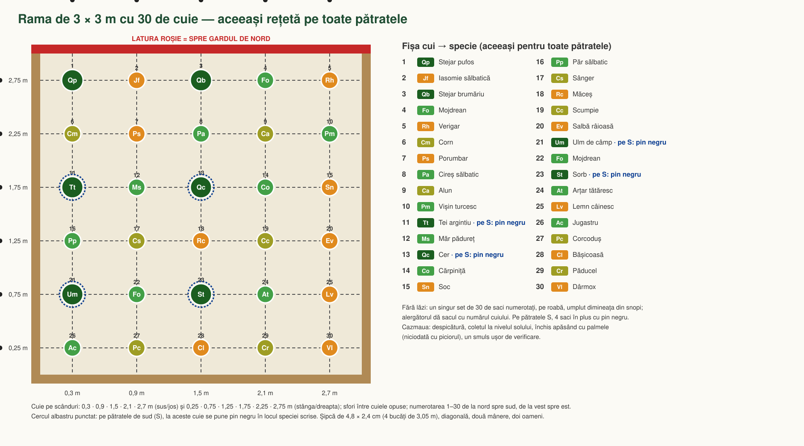

> **Varianta 4, de lucru** — caroiaj de 3 × 3 m cu 30 de cuie și o singură rețetă (8 noiembrie 2026), fără lăzi: fiecare specie are mereu același cui; pe banda de sud, 4 cuie de arbori mari primesc pin negru. Schemele 1–3 rămân ca referință.

# Pădure Miyawaki în colțul de nord-est — Crucea

Schema interactivă: [index-est.html](https://schmicky.github.io/crucea/miyawaki/index-est4.html), desenată cu **gardul de nord orizontal, sus** (nordul geografic la 29° spre dreapta, ca săgeata). Butonul „Tipărește” scoate schema pe pagina 1, legenda pe pagina 2 și apoi **câte o pagină pentru fiecare specie**: schema numai cu puieții acelei specii (numerotați ca în CSV, ceilalți gri), unde se așază (câți în interiorul cârligului, câți pe manta de hotar, câți lângă alee și luminiș) și cum se plantează (strat, distanțe, recepție) · pozițiile: `plantare-miyawaki-est.json` (metri locali cu nordul în sus și procente pe planul nord, pentru suprapunere).

## 1. Zona

Poligonul măsurat în aplicația planului nord („Contur 1”, 8 laturi), cu latura de nord trasă până la **0,5 m de gardul de nord** (la cererea beneficiarului; poligonul ajustat e în `plantare-miyawaki-est.json`, cheia `poligon_pct`): **345.6 m²**, în **colțul de nord-est al curții, pe perdeaua de est**: 19 m de-a lungul gardului de est (la 0,3–0,5 m de el), 20 m de-a lungul gardului de nord (la 0,5 m), lat de 13–21 m. Casa e la 56 m, sera la 40 m, iazul la 25 m: niciun efect de umbră, rădăcini sau frunze asupra lor. Livada caldă rămâne la sud, în soare.

Ce face pădurea aici:

- **îngroașă perdeaua de crivăț**: vântul de nord-est lovește latura lungă la 20° de perpendiculară; 15 m de pădure protejează 150 m de curte, adică tot lotul;
- **ia locul perdelei de est planificate** pe acest colț: perdeaua nu e plantată încă, așa că cele 33 de plante ale ei din interiorul poligonului (sălcioară 9, frasin 5, dud alb 4, pin negru 4, corn 3, ulm de turkestan 3, măceș 2, stejar pufos 1, păducel 1, pom de stafide 1) **se scot din planul nord**, iar pădurea, de 3 plante/m², face aceeași treabă mai bine. Din planul perdelei e preluat **pinul negru** (28 buc., strat A, **pe banda de sud a pădurii**, la 1,2–4 m de marginea dinspre grădină): e singura specie verde iarna și ține crivățul când foioasele sunt desfrunzite; stă pe margine pentru că e specie de lumină — pinul din Parcul Tăbăcărie, plantat între foioase, a rămas cu trunchi sănătos și coroană rară;
- restul perdelei de est (la sud de poligon) și perdeaua de nord rămân cum sunt în plan; pădurea e capătul lor gros din colț.

Reguli de hotar (Cod civil art. 613): pe primii **2 m de la gardul de est și de nord stau numai arbuști** (stratul D), subarboretul de la 1 m, arborii mici și mari de la 2 m. Arbuștii de pe hotar depășesc 2 m la maturitate (lemn câinesc 3 m, porumbar 3–4 m), deci fâșia e un gard viu în înțelesul obiceiului locului, nu o retragere legală strictă; drajonii de porumbar se cosesc pe linia gardului. Mantaua de arbuști de pe gard (păducel, porumbar, lemn câinesc, măceș) ține locul sălcioarelor din planul perdelei. Umbra de după-amiază cade peste gardul de est, pe terenul vecinului, pe 19 m de hotar; perdeaua planificată ar fi făcut același lucru cu pini și frasini de 12–30 m, dar merită o vorbă cu vecinul înainte de plantare.

## 2. Cifre

| | |
|---|---:|
| suprafață | 345.6 m², din care ≈ 25 m² alee și luminiș |
| puieți | 899 |
| densitate | 3 / m² |
| specii | 30 (cele 29 din celelalte variante + pin negru) |
| arbori mari (A) | 78 |
| arbori mici (B) | 153 |
| subarboret (C) | 237 |
| arbuști, manta (D) | 368 |

**Aleea** de 80 cm e un traseu propus (8 puncte, ≈ 29 m), netezit în curbe largi: **intră dinspre nord-vest**, de pe latura 2–3 a poligonului, lângă colțul de vest, urcă spre nord-est, **ocolește luminișul la 4–5 m prin nord și est** și intră în el dinspre sud. Toate curbele au raza de cel puțin 3 m, ca roaba să treacă fără să calce marginea și ca inelul de pădure dintre alee și luminiș (2,5–3 m) să fie plantabil. **Luminișul rotund de 10 m²** (3,6 m diametru), cu băncuța de 1,6 m pe partea opusă intrării, e așezat în punctul cel mai depărtat de marginile pădurii: **cel puțin 6 m de pădure de jur împrejur**, singurul loc din poligon unde e posibil. Aleea are nevoie de bordură (scândură pe muchie sau nuiele), altfel mulciul de 20 cm curge pe pietriș. **Interiorul buclei** (inelul dintre alee și luminiș, plus zona dintre brațul de intrare și cel de întoarcere) e plantat numai cu arbuști și subarboret, cu speciile cele mai dese pe margine (lemn câinesc, porumbar, păducel, corn, sânger, dârmox, scumpie), fără niciun arbore mic sau mare: un perete verde compact de la sol, care ascunde băncuța de la intrare și de pe tot ocolul. Pozițiile aleii sunt în `plantare-miyawaki-est.json` (cheile `poteca`, `poteca_pct`, `carlig`) și se pot muta în aplicația planului nord. Arborii mari stau la peste 1,3 m de alee, arborii mici la peste 0,9 m; luminișul e înconjurat de arbuști și subarboret, deci la 4–5 ani băncuța e într-o cameră verde, nu sub coroane.

**De modificat în planul nord:** cele 33 de plante ale perdelei de est din interiorul poligonului se șterg din `pozitie-nord.json` (lista e în `plantare-miyawaki-est.json`, cheia `plante_plan_nord_in_zona`), iar comenzile de noiembrie scad cu ele: sălcioară −9, frasin −5, dud alb −4, pin negru −4, corn −3, ulm de turkestan −3, măceș −2, stejar pufos −1, păducel −1, pom de stafide −1 (ulmii sunt din rândul de pe nord, care intră acum în fâșia de 0,5 m). În schimb pădurea cere puieții din tabelele de mai jos.

## 3. Speciile

### Strat A — arbori mari
| Cod | Specie | Nume latin | Buc. | De ce | Puieți la pepiniere silvice |
|---|---|---|---:|---|---|
| Qp | Stejar pufos | *Quercus pubescens* | 11 | arborele-cheie al silvostepei dobrogene; 100 % rezistent la secetă | 3 oferte, de la 1.00 lei |
| Qb | Stejar brumăriu | *Quercus pedunculiflora* | 13 | stejarul de stepă al Dobrogei, frunze brumării | 8 oferte, de la 0.90 lei |
| Tt | Tei argintiu | *Tilia tomentosa* | 10 | crește repede, umbră, albine în iunie | 1 oferte, de la 2.50 lei |
| Qc | Cer | *Quercus cerris* | 4 | stejar rapid, tolerant la calcar | 7 oferte, de la 0.90 lei |
| Um | Ulm de câmp | *Ulmus minor* | 4 | autohton, rapid; puțini, din cauza grafiozei | 2 oferte, de la 0.90 lei |
| St | Sorb | *Sorbus torminalis* | 8 | rar, fructe pentru păsări, roșu toamna | pepinieră ornamentală (Mizil, Cobadin) sau înlocuitorii din pepiniere-mizil-cobadin.md |
| Pn | Pin negru | *Pinus nigra* | 28 | conifer, singura specie verde iarna: ține crivățul când foioasele sunt desfrunzite; preluat din planul perdelei de est | pepinieră ornamentală (Mizil, Cobadin) sau înlocuitorii din pepiniere-mizil-cobadin.md |

### Strat B — arbori mici
| Cod | Specie | Nume latin | Buc. | De ce | Puieți la pepiniere silvice |
|---|---|---|---:|---|---|
| Fo | Mojdrean | *Fraxinus ornus* | 32 | flori parfumate în mai; specie de bază în pădurile Babadag | 5 oferte, de la 0.24 lei |
| Ac | Jugastru | *Acer campestre* | 21 | umple stratul mijlociu, galben toamna | pepinieră ornamentală (Mizil, Cobadin) sau înlocuitorii din pepiniere-mizil-cobadin.md |
| At | Arțar tătăresc | *Acer tataricum* | 22 | samare roșii, tipic silvostepei | pepinieră ornamentală (Mizil, Cobadin) sau înlocuitorii din pepiniere-mizil-cobadin.md |
| Co | Cărpiniță | *Carpinus orientalis* | 26 | arborele Dobrogei de piatră; frunziș des, ține umbra | pepinieră ornamentală (Mizil, Cobadin) sau înlocuitorii din pepiniere-mizil-cobadin.md |
| Pp | Păr sălbatic | *Pyrus pyraster* | 15 | flori în aprilie, pere mici pentru păsări | 1 oferte, de la 2.50 lei |
| Pm | Vișin turcesc | *Prunus mahaleb* | 13 | parfum, fructe, calcar | 1 oferte, de la 1.00 lei |
| Pa | Cireș sălbatic | *Prunus avium* | 6 | crește repede, flori, cireșe pentru păsări | 6 oferte, de la 0.93 lei |
| Ms | Măr pădureț | *Malus sylvestris* | 18 | flori roz, mere mici iarna pentru păsări | 2 oferte, de la 1.50 lei |

### Strat C — subarboret
| Cod | Specie | Nume latin | Buc. | De ce | Puieți la pepiniere silvice |
|---|---|---|---:|---|---|
| Cm | Corn | *Cornus mas* | 53 | flori în martie, coarne; lemn tare | pepinieră ornamentală (Mizil, Cobadin) sau înlocuitorii din pepiniere-mizil-cobadin.md |
| Cr | Păducel | *Crataegus monogyna* | 53 | cuiburi, flori, fructe; ghimpos | 2 oferte, de la 1.00 lei |
| Ca | Alun | *Corylus avellana* | 36 | alune, umbră deasă la sol | pepinieră ornamentală (Mizil, Cobadin) sau înlocuitorii din pepiniere-mizil-cobadin.md |
| Cs | Sânger | *Cornus sanguinea* | 35 | ramuri roșii iarna, fructe pentru păsări | 2 oferte, de la 1.02 lei |
| Cc | Scumpie | *Cotinus coggygria* | 34 | roșu toamna, calcar uscat | pepinieră ornamentală (Mizil, Cobadin) sau înlocuitorii din pepiniere-mizil-cobadin.md |
| Pc | Corcoduș | *Prunus cerasifera* | 26 | primul înflorit, fructe | 4 oferte, de la 0.80 lei |

### Strat D — arbuști și manta
| Cod | Specie | Nume latin | Buc. | De ce | Puieți la pepiniere silvice |
|---|---|---|---:|---|---|
| Lv | Lemn câinesc | *Ligustrum vulgare* | 66 | manta deasă, semipersistent | 2 oferte, de la 1.00 lei |
| Ps | Porumbar | *Prunus spinosa* | 57 | manta ghimpoasă, flori în martie | pepinieră ornamentală (Mizil, Cobadin) sau înlocuitorii din pepiniere-mizil-cobadin.md |
| Vl | Dârmox | *Viburnum lantana* | 56 | frunze pâsloase, fructe roșii-negre | pepinieră ornamentală (Mizil, Cobadin) sau înlocuitorii din pepiniere-mizil-cobadin.md |
| Rc | Măceș | *Rosa canina* | 40 | măceșe, adăpost | 5 oferte, de la 1.00 lei |
| Ev | Salbă râioasă | *Euonymus verrucosus* | 34 | arbust de pădure de stejar; fructe toxice | pepinieră ornamentală (Mizil, Cobadin) sau înlocuitorii din pepiniere-mizil-cobadin.md |
| Rh | Verigar | *Rhamnus cathartica* | 37 | fluturi (lămâița), fructe pentru păsări | pepinieră ornamentală (Mizil, Cobadin) sau înlocuitorii din pepiniere-mizil-cobadin.md |
| Jf | Iasomie sălbatică | *Jasminum fruticans* | 25 | specie dobrogeană, flori galbene | pepinieră ornamentală (Mizil, Cobadin) sau înlocuitorii din pepiniere-mizil-cobadin.md |
| Sn | Soc | *Sambucus nigra* | 23 | flori, fructe; crește repede | pepinieră ornamentală (Mizil, Cobadin) sau înlocuitorii din pepiniere-mizil-cobadin.md |
| Cl | Bășicoasă | *Colutea arborescens* | 30 | fixează azot, păstăi pentru copii | pepinieră ornamentală (Mizil, Cobadin) sau înlocuitorii din pepiniere-mizil-cobadin.md |

Pentru speciile care nu se găsesc la pepiniere (cărpiniță, salbă râioasă, verigar, iasomie sălbatică, bășicoasă), înlocuitorii sunt în `resurse/oferte/pepiniere-mizil-cobadin.md`.

## 4. Pregătire, plantare, întreținere

Ca în varianta de 9 × 12 m (`plan-miyawaki.md`), scalate la suprafață. Pinii negri se iau cu balot sau din container (nu rădăcină nudă) și se plantează în interior, la cel puțin 2 m unul de altul. Cantități: **35–45 m³ de compost**, mulci 15–20 cm (≈ 60 m³ tocătură sau 135 de baloți de paie), plasă de iepuri pe laturile dinspre curte (≈ 55 m; gardurile de hotar există), udare 20–25 l/m² o dată pe săptămână în anul 1 (≈ 7 500 l pe udare), nimic din anul 4. Echipă: 4 oameni plantează cei 836 de puieți în două zile.

Zăpada: perdeaua densă de pe nord-est depune troianul la 15–45 m în curte, spre livadă; să nu fie acolo o alee de acces de iarnă.

Legătura cu irigarea planului nord: zona preia vana V2 (est, uscat) și o parte din V3; are nevoie de un circuit propriu cu ≈ 900 m de tub de 16 mm cu picurătoare integrate la 33 cm, așezat șerpuit la 60 cm, sub mulci.

## 5. Cost orientativ

| | lei |
|---|---:|
| puieți din pepiniere silvice (≈ 500 buc., inclusiv pin negru) | 650–900 |
| puieți din pepiniere ornamentale (≈ 450 buc., 4–8 lei) | 1 800–3 600 |
| compost / gunoi fermentat 40 m³, cu transport | 4 500–8 000 |
| mulci | 2 000–4 000 |
| excavator mic, 2–3 zile | 1 600–3 600 |
| plasă de iepuri 55 m + țăruși | 650–900 |
| băncuță | 300–800 |
| **Total** | **≈ 11 500–22 000** |

Din comenzile de noiembrie ale planului nord dispar cele 34 de plante ale perdelelor din acest colț (≈ 150–300 lei).

Fără manoperă și fără apă.

## 6. Caroiaj de 3 × 3 m, o singură rețetă (varianta 4, 8 noiembrie 2026)

Plantarea se face cu o **ramă de 3 × 3 m** mutată pe teren, cu **30 de poziții** fixe (5 coloane la 0,6 m × 6 rânduri la 0,5 m, numerotate 1–30 de la nord spre sud și de la vest spre est); latura de nord a ramei e roșie și stă mereu spre gardul de nord. Arborii mari sunt la cuiele 1, 3, 11, 13, 21, 23, la cel puțin 1.0 m unul de altul, și în pătratele vecine.

**O singură rețetă**: fiecare dintre cele 29 de specii (fără pin) are mereu același cui, în orice pătrat; mojdreanul are două. Pe pătratele de sud (S), cuiele 11, 13, 21, 23 primesc pin negru în locul cerului, ulmului, sorbului și teiului. Un pătrat are 30 de puieți, 3,3/m²; aceeași specie se repetă la 3 m. **Fără lăzi**: un singur set de 30 de saci numerotați pe roabă, umplut dimineața din snopi; alergătorul dă sacul cu numărul cuiului.

**Regula de sărit, singura:** Se plantează doar cuiele care cad în pădure: cuiul care cade pe alee, în luminiș sau dincolo de linia de var se sare, fără înlocuire. Aceeași rețetă pe toate pătratele; pe cele de sud, patru cuie de arbori mari primesc pin negru. Plantele cu spini care ajung lângă alee se taie la sol în anul 2. Luminișul rămâne umbrit.

**Fâșia de la gard (F), 194 puieți, se plantează prima, pe linie, fără ramă:** Fâșia dintre linia de var și caroiaj, de-a lungul gardurilor de nord și de est: trei rânduri la 0,8, 1,3 și 1,8 m de gard, plante la 0,6 m pe rând, speciile în rotație; se plantează pe linie, cu sfoara, fără ramă, înaintea pătratelor. Rotația speciilor: Cs → Rh → Ps → Cm → Vl → Cc → Rc → Lv → Ps → Lv → Ev → Cr, și de la capăt.

Totaluri: 899 de puieți (A 145, B 213, C 199, D 342); 34 de pătrate (I 22, S 12), 30 pini pe banda de sud. Trasarea: conturul cu alb, caroiajul de 3 m cu roșu (16 linii), eticheta pătratului în colțul de nord-vest.

**Fișa cui → specie** (rețeta I; pe S, cuiele marcate primesc pin negru)

| Cui | Cod | Specie | Strat |
|---|---|---|---|
| 1 | Qp | Stejar pufos | arbore mare |
| 2 | Jf | Iasomie sălbatică | arbust |
| 3 | Qb | Stejar brumăriu | arbore mare |
| 4 | Fo | Mojdrean | arbore mic |
| 5 | Rh | Verigar | arbust |
| 6 | Cm | Corn | subarboret |
| 7 | Ps | Porumbar | arbust |
| 8 | Pa | Cireș sălbatic | arbore mic |
| 9 | Ca | Alun | subarboret |
| 10 | Pm | Vișin turcesc | arbore mic |
| 11 | Tt | Tei argintiu — pe S: pin negru | arbore mare |
| 12 | Ms | Măr pădureț | arbore mic |
| 13 | Qc | Cer — pe S: pin negru | arbore mare |
| 14 | Co | Cărpiniță | arbore mic |
| 15 | Sn | Soc | arbust |
| 16 | Pp | Păr sălbatic | arbore mic |
| 17 | Cs | Sânger | subarboret |
| 18 | Rc | Măceș | arbust |
| 19 | Cc | Scumpie | subarboret |
| 20 | Ev | Salbă râioasă | arbust |
| 21 | Um | Ulm de câmp — pe S: pin negru | arbore mare |
| 22 | Fo | Mojdrean | arbore mic |
| 23 | St | Sorb — pe S: pin negru | arbore mare |
| 24 | At | Arțar tătăresc | arbore mic |
| 25 | Lv | Lemn câinesc | arbust |
| 26 | Ac | Jugastru | arbore mic |
| 27 | Pc | Corcoduș | subarboret |
| 28 | Cl | Bășicoasă | arbust |
| 29 | Cr | Păducel | subarboret |
| 30 | Vl | Dârmox | arbust |

### Lista pătratelor — în ordinea plantării

| Pătrat | Rețetă | Puieți | Cuie sărite |
|---|---|---:|---|
| A1 | I | 24 | 16 (pe alee); 21 (pe alee); 22 (pe alee); 26 (pe alee); 27 (pe alee); 28 (pe alee) |
| B1 | I | 16 | 6 (pe alee); 7 (pe alee); 11 (pe alee); 12 (pe alee); 13 (pe alee); 14 (pe alee); 15 (pe alee); 16 (pe alee); 17 (pe alee); 18 (pe alee); 19 (pe alee); 20 (pe alee); 24 (pe alee); 25 (pe alee) |
| C1 | I | 16 | 9 (pe alee); 10 (pe alee); 11 (pe alee); 12 (pe alee); 13 (pe alee); 14 (pe alee); 15 (pe alee); 16 (pe alee); 17 (pe alee); 18 (pe alee); 19 (pe alee); 20 (pe alee); 21 (pe alee); 22 (pe alee) |
| D1 | I | 17 | 15 (pe alee); 18 (pe alee); 19 (pe alee); 20 (pe alee); 21 (pe alee); 22 (pe alee); 23 (pe alee); 24 (pe alee); 25 (pe alee); 26 (pe alee); 27 (pe alee); 28 (pe alee); 29 (pe alee) |
| E1 | I | 28 | 29 (pe alee); 30 (pe alee) |
| F1 | I | 30 | — |
| A2 | I | 16 | 2 (pe alee); 3 (pe alee); 4 (pe alee); 8 (pe alee); 9 (pe alee); 13 (pe alee); 14 (pe alee); 15 (pe alee); 19 (pe alee); 20 (pe alee); 24 (pe alee); 25 (pe alee); 29 (pe alee); 30 (pe alee) |
| B2 | I | 18 | 16 (în luminiș); 17 (în luminiș); 18 (în luminiș); 21 (în luminiș); 22 (în luminiș); 23 (în luminiș); 24 (în luminiș); 26 (în luminiș); 27 (în luminiș); 28 (în luminiș); 29 (în luminiș); 30 (în luminiș) |
| C2 | I | 26 | 20 (în luminiș); 25 (în luminiș); 29 (în luminiș); 30 (în luminiș) |
| D2 | I | 29 | 1 (pe alee) |
| E2 | I | 17 | 3 (pe alee); 4 (pe alee); 5 (pe alee); 7 (pe alee); 8 (pe alee); 9 (pe alee); 10 (pe alee); 11 (pe alee); 12 (pe alee); 13 (pe alee); 16 (pe alee); 17 (pe alee); 21 (pe alee) |
| F2 | I | 21 | 20 (pe alee); 21 (dincolo de var); 24 (pe alee); 25 (pe alee); 26 (dincolo de var); 27 (dincolo de var); 28 (pe alee); 29 (pe alee); 30 (pe alee) |
| A3 | I | 16 | 4 (pe alee); 5 (pe alee); 9 (pe alee); 10 (pe alee); 14 (pe alee); 15 (pe alee); 19 (pe alee); 20 (pe alee); 23 (pe alee); 24 (pe alee); 25 (pe alee); 27 (pe alee); 28 (pe alee); 29 (pe alee) |
| B3 | I | 7 | 1 (în luminiș); 2 (în luminiș); 3 (în luminiș); 4 (în luminiș); 5 (în luminiș); 6 (în luminiș); 7 (în luminiș); 8 (în luminiș); 9 (în luminiș); 10 (în luminiș); 11 (în luminiș); 12 (pe alee); 13 (în luminiș); 14 (în luminiș); 16 (în luminiș); 17 (pe alee); 18 (pe alee); 19 (în luminiș); 21 (în luminiș); 22 (pe alee); 23 (pe alee); 27 (pe alee); 28 (pe alee) |
| C3 | I | 23 | 4 (în luminiș); 5 (în luminiș); 9 (în luminiș); 10 (în luminiș); 14 (în luminiș); 15 (în luminiș); 20 (în luminiș) |
| D3 | I | 30 | — |
| E3 | S | 24 | 16 (dincolo de var); 21 (dincolo de var); 22 (dincolo de var); 26 (dincolo de var); 27 (dincolo de var); 28 (dincolo de var) |
| F3 | I | 1 | 1 (dincolo de var); 2 (dincolo de var); 3 (dincolo de var); 4 (pe alee); 5 (pe alee); 6 (dincolo de var); 7 (dincolo de var); 8 (dincolo de var); 9 (dincolo de var); 11 (dincolo de var); 12 (dincolo de var); 13 (dincolo de var); 14 (dincolo de var); 15 (dincolo de var); 16 (dincolo de var); 17 (dincolo de var); 18 (dincolo de var); 19 (dincolo de var); 20 (dincolo de var); 21 (dincolo de var); 22 (dincolo de var); 23 (dincolo de var); 24 (dincolo de var); 25 (dincolo de var); 26 (dincolo de var); 27 (dincolo de var); 28 (dincolo de var); 29 (dincolo de var); 30 (dincolo de var) |
| A4 | I | 22 | 1 (pe alee); 2 (pe alee); 3 (pe alee); 4 (pe alee); 6 (pe alee); 7 (pe alee); 8 (pe alee); 11 (pe alee) |
| B4 | I | 18 | 2 (pe alee); 3 (pe alee); 7 (pe alee); 8 (pe alee); 9 (pe alee); 10 (pe alee); 12 (pe alee); 13 (pe alee); 14 (pe alee); 15 (pe alee); 18 (pe alee); 19 (pe alee) |
| C4 | I | 30 | — |
| D4 | S | 29 | 26 (dincolo de var) |
| E4 | S | 4 | 1 (dincolo de var); 2 (dincolo de var); 3 (dincolo de var); 6 (dincolo de var); 7 (dincolo de var); 8 (dincolo de var); 9 (dincolo de var); 11 (dincolo de var); 12 (dincolo de var); 13 (dincolo de var); 14 (dincolo de var); 16 (dincolo de var); 17 (dincolo de var); 18 (dincolo de var); 19 (dincolo de var); 20 (dincolo de var); 21 (dincolo de var); 22 (dincolo de var); 23 (dincolo de var); 24 (dincolo de var); 25 (dincolo de var); 26 (dincolo de var); 27 (dincolo de var); 28 (dincolo de var); 29 (dincolo de var); 30 (dincolo de var) |
| A5 | I | 30 | — |
| B5 | I | 30 | — |
| C5 | S | 30 | — |
| D5 | S | 15 | 1 (dincolo de var); 6 (dincolo de var); 7 (dincolo de var); 11 (dincolo de var); 12 (dincolo de var); 16 (dincolo de var); 17 (dincolo de var); 18 (dincolo de var); 21 (dincolo de var); 22 (dincolo de var); 23 (dincolo de var); 26 (dincolo de var); 27 (dincolo de var); 28 (dincolo de var); 29 (dincolo de var) |
| A6 | S | 30 | — |
| B6 | S | 30 | — |
| C6 | S | 30 | — |
| D6 | S | 3 | 1 (dincolo de var); 2 (dincolo de var); 3 (dincolo de var); 4 (dincolo de var); 6 (dincolo de var); 7 (dincolo de var); 8 (dincolo de var); 9 (dincolo de var); 11 (dincolo de var); 12 (dincolo de var); 13 (dincolo de var); 14 (dincolo de var); 16 (dincolo de var); 17 (dincolo de var); 18 (dincolo de var); 19 (dincolo de var); 20 (dincolo de var); 21 (dincolo de var); 22 (dincolo de var); 23 (dincolo de var); 24 (dincolo de var); 25 (dincolo de var); 26 (dincolo de var); 27 (dincolo de var); 28 (dincolo de var); 29 (dincolo de var); 30 (dincolo de var) |
| A7 | S | 15 | 16 (dincolo de var); 17 (dincolo de var); 18 (dincolo de var); 19 (dincolo de var); 20 (dincolo de var); 21 (dincolo de var); 22 (dincolo de var); 23 (dincolo de var); 24 (dincolo de var); 25 (dincolo de var); 26 (dincolo de var); 27 (dincolo de var); 28 (dincolo de var); 29 (dincolo de var); 30 (dincolo de var) |
| B7 | S | 15 | 16 (dincolo de var); 17 (dincolo de var); 18 (dincolo de var); 19 (dincolo de var); 20 (dincolo de var); 21 (dincolo de var); 22 (dincolo de var); 23 (dincolo de var); 24 (dincolo de var); 25 (dincolo de var); 26 (dincolo de var); 27 (dincolo de var); 28 (dincolo de var); 29 (dincolo de var); 30 (dincolo de var) |
| C7 | S | 15 | 16 (dincolo de var); 17 (dincolo de var); 18 (dincolo de var); 19 (dincolo de var); 20 (dincolo de var); 21 (dincolo de var); 22 (dincolo de var); 23 (dincolo de var); 24 (dincolo de var); 25 (dincolo de var); 26 (dincolo de var); 27 (dincolo de var); 28 (dincolo de var); 29 (dincolo de var); 30 (dincolo de var) |

### Cantități — ce se comandă

| Cod | Specie | Strat | În pătrate | În fâșie | În schemă | De comandat (+10 %) |
|---|---|---|---:|---:|---:|---:|
| Qp | Stejar pufos | arbore mare | 27 | 0 | 27 | 30 |
| Qb | Stejar brumăriu | arbore mare | 26 | 0 | 26 | 29 |
| Tt | Tei argintiu | arbore mare | 16 | 0 | 16 | 18 |
| Qc | Cer | arbore mare | 15 | 0 | 15 | 17 |
| Um | Ulm de câmp | arbore mare | 14 | 0 | 14 | 16 |
| St | Sorb | arbore mare | 17 | 0 | 17 | 19 |
| Fo | Mojdrean | arbore mic | 47 | 0 | 47 | 52 |
| Ac | Jugastru | arbore mic | 21 | 0 | 21 | 24 |
| At | Arțar tătăresc | arbore mic | 22 | 0 | 22 | 25 |
| Co | Cărpiniță | arbore mic | 24 | 0 | 24 | 27 |
| Pp | Păr sălbatic | arbore mic | 20 | 0 | 20 | 22 |
| Pm | Vișin turcesc | arbore mic | 28 | 0 | 28 | 31 |
| Pa | Cireș sălbatic | arbore mic | 26 | 0 | 26 | 29 |
| Ms | Măr pădureț | arbore mic | 25 | 0 | 25 | 28 |
| Cm | Corn | subarboret | 27 | 16 | 43 | 48 |
| Cr | Păducel | subarboret | 20 | 16 | 36 | 40 |
| Ca | Alun | subarboret | 24 | 0 | 24 | 27 |
| Cs | Sânger | subarboret | 22 | 17 | 39 | 43 |
| Cc | Scumpie | subarboret | 21 | 16 | 37 | 41 |
| Pc | Corcoduș | subarboret | 20 | 0 | 20 | 22 |
| Lv | Lemn câinesc | arbust | 22 | 32 | 54 | 60 |
| Ps | Porumbar | arbust | 25 | 32 | 57 | 63 |
| Vl | Dârmox | arbust | 23 | 16 | 39 | 43 |
| Rc | Măceș | arbust | 21 | 16 | 37 | 41 |
| Ev | Salbă râioasă | arbust | 20 | 16 | 36 | 40 |
| Rh | Verigar | arbust | 29 | 17 | 46 | 51 |
| Jf | Iasomie sălbatică | arbust | 27 | 0 | 27 | 30 |
| Sn | Soc | arbust | 26 | 0 | 26 | 29 |
| Cl | Bășicoasă | arbust | 20 | 0 | 20 | 22 |
| Pn | Pin negru | arbore mare | 30 | 0 | 30 | 33 |
| | **Total** | | 705 | 194 | **899** | **1000** |
